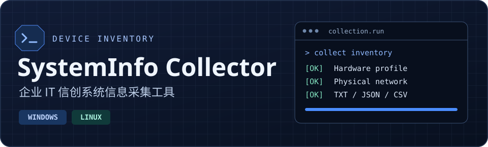

<p align="center">
  
</p>

<p align="center">
  <a href="https://github.com/wzb83889/xinchuang-system-info-collector/releases/latest"></a>
  <a href="https://github.com/wzb83889/xinchuang-system-info-collector/actions/workflows/build.yml"></a>
  
  
</p>

<p align="center">
  <a href="#快速开始">快速开始</a> ·
  <a href="#批量采集与汇总">批量采集与汇总</a> ·
  <a href="#构建与测试">构建与测试</a> ·
  <a href="CHANGELOG.md">更新记录</a>
</p>

# 企业 IT 信创系统信息采集工具

面向企业设备盘点、硬件复核和信创环境初筛。Windows 提供交互式采集、批量归档和汇总，Linux 提供本机采集脚本。两端均可输出 TXT、JSON 和 CSV 报告。

## 快速开始

| 平台 | 入口 | 运行条件 |
| --- | --- | --- |
| Windows | 在 [Release](https://github.com/wzb83889/xinchuang-system-info-collector/releases/latest) 下载 Windows ZIP，解压后运行 `SystemInfoCollector-Windows.exe` | Windows 7 SP1 / 8.1 / 10 / 11，已安装 .NET Framework 4.8 |
| Linux | 下载同页的 `systeminfo-linux.sh`，在终端执行 | POSIX Shell，普通用户权限 |

Windows 主菜单可用 **1** 查看简要信息、用 **2** 执行完整检测、用 **5** 进入报告菜单。

```sh
sh ./systeminfo-linux.sh
sh ./systeminfo-linux.sh --output "$HOME/设备报告"
sh ./systeminfo-linux.sh --print
```

Linux 发行版规则覆盖统信 UOS、银河麒麟、中标麒麟、openKylin、openEuler、麒麟信安、Loongnix、Anolis OS、Asianux、中科方德、红旗 Linux 和 Deepin。脚本读取 `/etc/os-release`、`/proc`、`/sys`，按可用性调用 `lsblk`、`ip`、`lspci`、`aplay` 和 `lpstat`。权限不足或命令缺失时，相关字段标记为未提供。

## 批量采集与汇总

### 员工采集 · Windows 菜单 5 → 2

设定管理员提供的 WebDAV 地址和账号，运行时输入密码。也可在菜单提示时输入地址，或使用有写权限的本地 / SMB 绝对路径。

```powershell
$env:SYSTEMINFO_COLLECT_URL = "https://dav.example.com/DeviceReports"
$env:SYSTEMINFO_COLLECT_USER = "inventory-user"
.\SystemInfoCollector-Windows.exe --collect
```

1. 程序检查 WebDAV 服务并显示进度。连接失败时可改填地址，或回车取消。
2. 登录后验证临时目录和文件的写入及清理。通过后登记部门、使用人员姓名、门牌号 / 工位号。
3. 采集并上传三种报告。只要 Windows 能读取 MAC，已禁用或断开连接的物理网卡仍纳入报告。缺少必要网卡或 MAC 时暂停，可修正后仅重试网络模块。

菜单预检成功后会记住 WebDAV 地址。环境变量指定的地址优先于缓存。密码仅用于当次会话。日常使用可通过 HTTPS 和交互式密码输入完成。非交互参数见 `--help`，归集失败返回非零退出码。

### 管理员汇总 · Windows 菜单 5 → 3

选择存有报告 CSV 的共享目录或本地目录，也可以通过命令行汇总。

```powershell
.\SystemInfoCollector-Windows.exe --merge "C:\DeviceReports"
```

物理网卡数量、MAC 采集结论和各网卡分别成列。有线排在无线前，超过两张时自动扩展列。下表使用模拟数据。

| 网卡数量 | MAC采集结论 | 网卡1 | 网卡2 |
| ---: | --- | --- | --- |
| 2 | 已采集 2/2 | 有线 · 已连接 · `02:11:22:33:44:55` | 无线 · 未连接 · `02:11:22:33:44:66` |

旧报告按列名归并。姓名缺失或含损坏字符时，同名 JSON 的采集时间和计算机名均一致且姓名有效才会恢复原文，其余情况在“姓名校验”列标记。旧网卡描述无法完整拆分时保留原文。

## 采集范围

| 能力 | Windows | Linux |
| --- | --- | --- |
| 资产标识 | 主机、厂商、型号、序列号、BIOS | 主机、厂商、型号、DMI / device-tree |
| 硬件信息 | CPU、内存、磁盘、显卡、音频、电池、显示器及外设 | CPU、内存、磁盘、网络、显卡、音频、电池及打印机，按系统可读性输出 |
| 网络信息 | 物理网卡、状态、永久 / 当前 MAC、IP | 接口、MAC、IP，按工具可用性输出 |
| 报告工作流 | 本地导出、WebDAV / SMB 批量归档、目录汇总 | 本地导出、终端查看 |
| 信创线索 | 厂商、型号、CPU、操作系统规则 | 厂商、型号、CPU、发行版规则 |

> 信创结果提供规则命中及线索分值。正式认定需要结合产品认证、采购台账和设备铭牌复核。

## 构建与测试

Windows 开发机需有 .NET Framework 4.8 开发包。回归套件使用本机模拟 WebDAV 和独立控制台。

```powershell
dotnet msbuild .\SystemInfoCollector.Windows.csproj /t:Rebuild /p:Configuration=Release /v:minimal
.\bin\Release\SystemInfoCollector-Windows.exe --self-test-xc
dotnet msbuild .\tests\SystemInfoCollector.Regression.csproj /t:Rebuild /p:Configuration=Release /v:minimal
"" | .\tests\bin\Release\SystemInfoCollector-Regression.exe
```

```sh
sh -n ./systeminfo-linux.sh
sh ./tests/run-linux-tests.sh
```

Linux 样例覆盖 UOS、银河麒麟、openEuler 与 openKylin。Windows 回归覆盖 Unicode 登记、旧 CSV、物理网卡和 WebDAV 重复归档。验证范围见 [开发调试复盘](docs/development-retrospective-fix2.md) 和 [发布前代码审查](docs/release-review-v1.3.1.md)。

## 数据与许可

- Windows 批量上传由菜单 5 → 2 或 `--collect` 触发。Linux 在本机生成报告。
- 提交公开反馈前，请脱敏序列号、UUID、MAC、IP、姓名和位置等数据。
- 当前仓库未授予开源再许可，保留全部权利。
